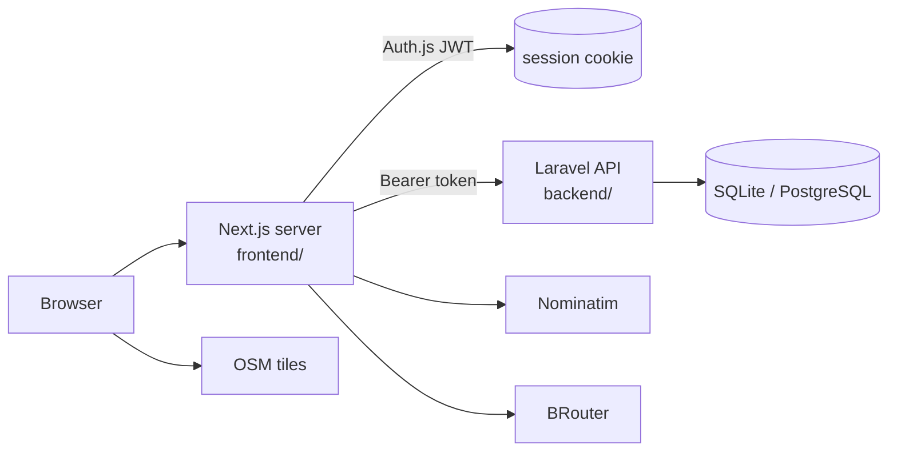

# CycleLine — project overview

Rider-first cycling planner: map routing, saved routes, bike garage, fitness-aware suggestions, public news journal, admin console. Working rules for agents: [`AGENTS.md`](../../AGENTS.md).

## Request / data flow
1. Login form → Auth.js credentials provider → `POST /api/auth/login` (`frontend/src/auth.ts:21`).
2. Sanctum token is stored in the Auth.js JWT, exposed as `session.accessToken` (`auth.ts:69-85`).
3. Pages and Server Actions call Laravel via `backendFetch` with that token (`frontend/src/lib/backend.ts:22`).
4. Planner calls `/api/geocode` then `/api/route` (Next route handlers) for coordinates and geometry.
5. Approved route is saved by `saveRouteAction` (`frontend/src/app/actions.ts:105`) → `POST /api/routes`.
6. Laravel controllers validate, enforce ownership/admin, and persist via Eloquent.

## Files
| File | Summary |
|---|---|
| [architecture.md](architecture.md) | Cross-service structure, auth and planner flows |
| [backend.md](backend.md) | Laravel API: routes, controllers, middleware, tests |
| [frontend.md](frontend.md) | Next.js app: pages, actions, proxies, auth |
| [data-model.md](data-model.md) | Tables, relations, cascade rules |
| [configuration.md](configuration.md) | Env vars per service and where they're set |
| [../API.md](../API.md) | Existing endpoint reference |
| [../DEPLOYMENT.md](../DEPLOYMENT.md) | Existing deployment guide (Vercel, Render, compose) |
| [../ARCHITECTURE.md](../ARCHITECTURE.md) | Existing architecture notes (ER diagram, guarantees) |
